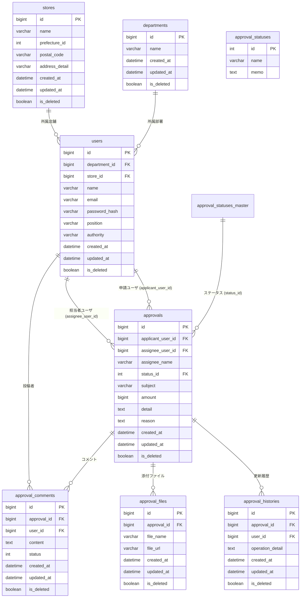

# データベース設計書 (DB.md)

`docs/spec.md` の要件・仕様を基にしたテーブル定義およびリレーション設計です。

---

## 1. テーブル一覧

| 論理テーブル名 | 物理テーブル名 | 概要 |
| --- | --- | --- |
| 稟議DB | `approvals` | 稟議申請の基本情報および内容（金額・詳細・理由）を管理するメインテーブル |
| ユーザDB | `users` | システムを利用するユーザ（起案者・承認者・担当者）および「その他ユーザ」を管理するテーブル |
| 部署DB | `departments` | ユーザが所属する部署マスタ (必要に応じて、情報を追加する) |
| 店舗DB | `stores` | ユーザが所属する店舗および所在地マスタ (必要に応じて、情報を追加する) |
| 稟議更新履歴DB | `approval_histories` | 稟議に対する操作・状態変更の監査ログ（履歴）を管理するテーブル |
| 稟議付与ファイル管理用DB | `approval_files` | 稟議に添付されたファイルのメタデータと保存先URLを管理するテーブル |
| 稟議コメント管理用DB | `approval_comments` | 稟議に対する承認者・起案者のコメントと既読/対応状態を管理するテーブル |
| 稟議ステータス | `approval_statuses_master` | 稟議の状態（申請中・承認済み・差し戻し・下書き）を定義するステータスマスタ |

---

## 2. テーブル詳細定義

### 2.1. 稟議DB (`approvals`)

稟議の起案内容（件名、金額、詳細、理由）と現在のステータスを保持します。
ステータスが `1: 承認済み` となった場合は起案者による編集が不可となり、`2: 差し戻し` または `3: 下書き` の場合は編集・申請（再申請）が可能な状態になります。

| 論理名 | 物理名 | データ型 | NULL | 制約 / デフォルト値 | 備考 |
| --- | --- | --- | --- | --- | --- |
| ID | `id` | `BIGINT` | NO | `PK`, `AUTO_INCREMENT` | 稟議一意ID |
| 申請ユーザ_ID | `applicant_user_id` | `BIGINT` | NO | `FK (users.id)` | 起案者のユーザID |
| 担当者ユーザ_ID | `assignee_user_id` | `BIGINT` | NO | `FK (users.id)`, `DEFAULT 0` | 担当者のユーザID（未定・外部の場合は不明ユーザID `0` を設定） |
| 担当者名 | `assignee_name` | `VARCHAR(100)` | YES | `DEFAULT NULL` | 担当者名（担当者未定の場合や外部担当者などの直接入力に備えて保持） |
| ステータス | `status_id` | `INT` | NO | `FK (approval_statuses_master.id)`, `DEFAULT 3` | `0`: 申請中 / `1`: 承認済み / `2`: 差し戻し / `3`: 下書き |
| 件名 | `subject` | `VARCHAR(255)` | NO | | 稟議の件名 |
| 内容：金額 | `amount` | `BIGINT` | NO | `DEFAULT 0` | 稟議の申請金額（円） |
| 内容：詳細 | `detail` | `TEXT` | NO | | 稟議内容の詳細 |
| 内容：理由 | `reason` | `TEXT` | NO | | 稟議申請の理由 |
| 作成日 | `created_at` | `DATETIME` | NO | `DEFAULT CURRENT_TIMESTAMP` | レコード作成日時（起案日） |
| 更新日 | `updated_at` | `DATETIME` | NO | `DEFAULT CURRENT_TIMESTAMP ON UPDATE CURRENT_TIMESTAMP` | レコード更新日時 |
| 削除フラグ | `is_deleted` | `BOOLEAN` | NO | `DEFAULT FALSE` | 論理削除フラグ（`FALSE`: 有効 / `TRUE`: 削除済み） |

---

### 2.2. ユーザDB (`users`)

起案者・承認者などのユーザ情報を管理します。
※担当者未定や外部担当者のケースに対応するため、初期データとして「不明なユーザ（例: `id = 0`）」を1件用意します。

| 論理名 | 物理名 | データ型 | NULL | 制約 / デフォルト値 | 備考 |
| --- | --- | --- | --- | --- | --- |
| ID | `id` | `BIGINT` | NO | `PK`, `AUTO_INCREMENT` | ユーザ一意ID（`0` は「不明なユーザ」用の予約レコード） |
| 部署_ID | `department_id` | `BIGINT` | YES | `FK (departments.id)` | 所属部署ID |
| 店舗_ID | `store_id` | `BIGINT` | YES | `FK (stores.id)` | 所属店舗ID |
| 担当者名 | `name` | `VARCHAR(100)` | NO | | ユーザ氏名（表示名） |
| メールアドレス | `email` | `VARCHAR(255)` | NO | `UNIQUE` | ログイン・通知用メールアドレス |
| パスワード | `password_hash` | `VARCHAR(255)` | NO | | ハッシュ化されたパスワード |
| 役職 | `position` | `VARCHAR(100)` | YES | `DEFAULT NULL` | 役職名（店長、部長、一般など） |
| 権限 | `authority` | `VARCHAR(50)` | NO | `DEFAULT 'applicant'` | システム権限（`applicant`: 起案者 / `approver`: 承認者 / `admin`: 管理者） |
| 作成日 | `created_at` | `DATETIME` | NO | `DEFAULT CURRENT_TIMESTAMP` | レコード作成日時 |
| 更新日 | `updated_at` | `DATETIME` | NO | `DEFAULT CURRENT_TIMESTAMP ON UPDATE CURRENT_TIMESTAMP` | レコード更新日時 |
| 削除フラグ | `is_deleted` | `BOOLEAN` | NO | `DEFAULT FALSE` | 論理削除フラグ |

---

### 2.3. 部署DB (`departments`)

| 論理名 | 物理名 | データ型 | NULL | 制約 / デフォルト値 | 備考 |
| --- | --- | --- | --- | --- | --- |
| ID | `id` | `BIGINT` | NO | `PK`, `AUTO_INCREMENT` | 部署一意ID |
| 部署名 | `name` | `VARCHAR(100)` | NO | | 部署名 |
| 作成日 | `created_at` | `DATETIME` | NO | `DEFAULT CURRENT_TIMESTAMP` | レコード作成日時 |
| 更新日 | `updated_at` | `DATETIME` | NO | `DEFAULT CURRENT_TIMESTAMP ON UPDATE CURRENT_TIMESTAMP` | レコード更新日時 |
| 削除フラグ | `is_deleted` | `BOOLEAN` | NO | `DEFAULT FALSE` | 論理削除フラグ |

---

### 2.4. 店舗DB (`stores`)

| 論理名 | 物理名 | データ型 | NULL | 制約 / デフォルト値 | 備考 |
| --- | --- | --- | --- | --- | --- |
| ID | `id` | `BIGINT` | NO | `PK`, `AUTO_INCREMENT` | 店舗一意ID |
| 店舗名 | `name` | `VARCHAR(100)` | NO | | 店舗名 |
| 住所：都道府県ID | `prefecture_id` | `INT` | NO | | 都道府県コード（JIS X 0401準拠: `1`〜`47`）※specの「県ID / 都道府県ID」を統合 |
| 住所：郵便番号 | `postal_code` | `VARCHAR(10)` | NO | | 郵便番号（ハイフンあり/なし対応、例: `100-0001`） |
| 住所：その他詳細住所 | `address_detail` | `VARCHAR(255)` | NO | | 市区町村・番地・建物名などの詳細住所 |
| 作成日 | `created_at` | `DATETIME` | NO | `DEFAULT CURRENT_TIMESTAMP` | レコード作成日時 |
| 更新日 | `updated_at` | `DATETIME` | NO | `DEFAULT CURRENT_TIMESTAMP ON UPDATE CURRENT_TIMESTAMP` | レコード更新日時 |
| 削除フラグ | `is_deleted` | `BOOLEAN` | NO | `DEFAULT FALSE` | 論理削除フラグ |

---

### 2.5. 稟議更新履歴DB (`approval_histories`)

稟議の作成・編集・承認・差し戻しなどの操作履歴を記録します。

| 論理名 | 物理名 | データ型 | NULL | 制約 / デフォルト値 | 備考 |
| --- | --- | --- | --- | --- | --- |
| ID | `id` | `BIGINT` | NO | `PK`, `AUTO_INCREMENT` | 履歴一意ID |
| 稟議_ID | `approval_id` | `BIGINT` | NO | `FK (approvals.id)` | 対象の稟議ID（※リレーション用に補足） |
| 操作ユーザ_ID | `user_id` | `BIGINT` | YES | `FK (users.id)` | 操作を行ったユーザID（※監査用に補足） |
| 操作内容 | `operation_detail` | `TEXT` | NO | | 実行された操作内容（新規申請、内容更新、承認、差し戻し等） |
| 作成日 | `created_at` | `DATETIME` | NO | `DEFAULT CURRENT_TIMESTAMP` | レコード作成日時（操作日時） |
| 更新日 | `updated_at` | `DATETIME` | NO | `DEFAULT CURRENT_TIMESTAMP ON UPDATE CURRENT_TIMESTAMP` | レコード更新日時 |
| 削除フラグ | `is_deleted` | `BOOLEAN` | NO | `DEFAULT FALSE` | 論理削除フラグ |

---

### 2.6. 稟議付与ファイル管理用DB (`approval_files`)

稟議に添付される見積書や参考資料などのファイルを管理します。

| 論理名 | 物理名 | データ型 | NULL | 制約 / デフォルト値 | 備考 |
| --- | --- | --- | --- | --- | --- |
| ID | `id` | `BIGINT` | NO | `PK`, `AUTO_INCREMENT` | ファイル一意ID |
| 稟議_ID | `approval_id` | `BIGINT` | NO | `FK (approvals.id)` | 紐づく稟議ID |
| ファイル名 | `file_name` | `VARCHAR(255)` | NO | | アップロード時の元ファイル名 |
| 対象ファイルURL | `file_url` | `VARCHAR(1024)` | NO | | ストレージ上の保存先パスまたはURL |
| 作成日 | `created_at` | `DATETIME` | NO | `DEFAULT CURRENT_TIMESTAMP` | レコード作成日時 |
| 更新日 | `updated_at` | `DATETIME` | NO | `DEFAULT CURRENT_TIMESTAMP ON UPDATE CURRENT_TIMESTAMP` | レコード更新日時 |
| 削除フラグ | `is_deleted` | `BOOLEAN` | NO | `DEFAULT FALSE` | 論理削除フラグ |

---

### 2.7. 稟議コメント管理用DB (`approval_comments`)

承認時・差し戻し時のフィードバックや質疑応答コメントを管理します。

| 論理名 | 物理名 | データ型 | NULL | 制約 / デフォルト値 | 備考 |
| --- | --- | --- | --- | --- | --- |
| ID | `id` | `BIGINT` | NO | `PK`, `AUTO_INCREMENT` | コメント一意ID |
| 稟議_ID | `approval_id` | `BIGINT` | NO | `FK (approvals.id)` | 紐づく稟議ID |
| ユーザID | `user_id` | `BIGINT` | NO | `FK (users.id)` | コメント投稿者のユーザID |
| コメント内容 | `content` | `TEXT` | NO | | コメント本文 |
| ステータス | `status` | `INT` | NO | `DEFAULT 0` | コメント状態（`0`: 未読 / `1`: 既読 / `2`: 対応済み） |
| 作成日 | `created_at` | `DATETIME` | NO | `DEFAULT CURRENT_TIMESTAMP` | レコード作成日時 |
| 更新日 | `updated_at` | `DATETIME` | NO | `DEFAULT CURRENT_TIMESTAMP ON UPDATE CURRENT_TIMESTAMP` | レコード更新日時 |
| 削除フラグ | `is_deleted` | `BOOLEAN` | NO | `DEFAULT FALSE` | 論理削除フラグ |

---

### 2.8. 稟議ステータス (`approval_statuses_master`)

稟議の状態を表すマスタテーブルです。

| 論理名 | 物理名 | データ型 | NULL | 制約 / デフォルト値 | 備考 |
| --- | --- | --- | --- | --- | --- |
| ID | `id` | `INT` | NO | `PK` | ステータスID（`0`: 申請中 / `1`: 承認済み / `2`: 差し戻し / `3`: 下書き） |
| 状態 | `name` | `VARCHAR(50)` | NO | | ステータス表示名 |
| メモ | `memo` | `TEXT` | YES | `DEFAULT NULL` | ステータスの説明・制御ルール等のメモ |

---

## 3. ER図

