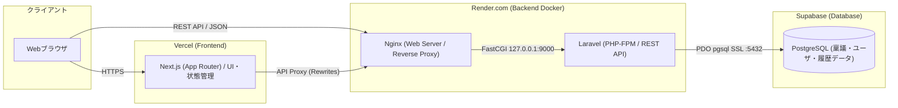
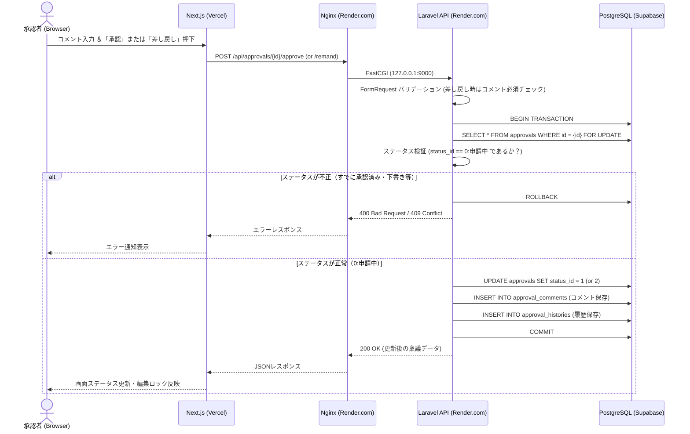

# システムアーキテクチャ設計書 (architecture.md)

本ドキュメントでは、稟議・承認ワークフローシステムにおける技術スタック、インフラ・デプロイ構成、ディレクトリ構造、およびアプリケーションのレイヤー設計を定義します。

---

## 1. 技術スタック一覧

| レイヤー | 採用技術 | ホスティング先（本番公開） | 役割・選定理由 |
| --- | --- | --- | --- |
| **フロントエンド** | **Next.js** (React / TypeScript / App Router) | **Vercel** | ・モダンなUI構築と高速なページ遷移<br>・Vercelへのシームレスなデプロイと最適化 |
| **Webサーバ** | **Nginx** | **Render.com** (Docker) | ・リバースプロキシおよびLaravel (PHP-FPM) へのFastCGI通信<br>・静的ファイル配信、セキュリティヘッダ制御 |
| **バックエンド** | **Laravel** (PHP 8.x / APIモード) | **Render.com** (Docker) | ・堅牢なルーティング、FormRequestによるバリデーション<br>・Eloquent ORMによるリレーション管理とトランザクション制御 |
| **データベース** | **PostgreSQL** | **Supabase** | ・厳格な型制約・外部キー制約と高いトランザクション整合性<br>・SupabaseのマネージドPostgreSQL（および必要に応じたSupabase Storage連携） |
| **ローカル開発環境** | **Docker Compose** | ローカルマシン | ・`Next.js` / `Nginx` / `PHP-FPM (Laravel)` / `PostgreSQL` のローカル完全再現 |

---

## 2. システム全体構成図

フロントエンド（Next.js on **Vercel**）、バックエンドAPI（Nginx + Laravel on **Render.com**）、データベース（PostgreSQL on **Supabase**）を分離した構成を採用します。

### 2.1. アーキテクチャ図



---

## 3. デプロイ・クラウド公開設計（Vercel × Render.com × Supabase）

### 3.1. 各クラウド基盤の接続・構成詳細

| コンポーネント | クラウドサービス | 構築・接続方式 |
| --- | --- | --- |
| **フロントエンド**<br>(Next.js) | **Vercel** | ・GitHubリポジトリの `frontend/` ディレクトリをRoot Directoryに指定してデプロイ。<br>・環境変数 `BACKEND_API_URL` に Render.com のURL（`https://xxx.onrender.com`）を設定。<br>・`next.config.mjs` の `rewrites` 機能で `/api/:path*` を Render.com 側へプロキシし、CORS問題を回避。 |
| **バックエンド ＋ Nginx**<br>(Laravel + Nginx) | **Render.com**<br>(Web Service / Docker) | ・GitHubリポジトリの `backend/` ディレクトリをRoot Directoryに指定し、`backend/Dockerfile` でデプロイ。<br>・Render.com の無料枠（Web Service）では **1コンテナ単位** でデプロイするため、`backend/Dockerfile` 内で **Nginx と PHP-FPM (Laravel) を同居**（`supervisord` で同時起動）させる。<br>・Nginxが Render の公開ポート（`:80` / `$PORT`）で待ち受け、`127.0.0.1:9000` の PHP-FPM へ FastCGI 転送する。 |
| **データベース**<br>(PostgreSQL) | **Supabase** | ・Supabase プロジェクトを作成し、提供される PostgreSQL 接続情報を Render.com の環境変数に設定。<br>・Laravelの `.env` にてSSL接続設定を行い安全に通信する（環境変数の詳細は `.env` および `docs/memo.md` を参照）。<br>・※添付ファイル（`approval_files`）の実体保存先としても、将来的に Supabase Storage (S3互換) をそのまま利用可能。 |

---

## 4. ディレクトリ構成（モノレポ構成）

ローカル開発（Docker Compose）と本番デプロイ（Vercel / Render.com）の両方で、`backend/` と `frontend/` それぞれが単体でビルド・デプロイ完結できるよう、各ディレクトリ直下に `Dockerfile` を配置する構成とします。

```text
PRJ_ApprovalSystem/
├── docker-compose.yml          # ローカル開発用 (frontend, backend, db)
├── render.yaml                 # Render.com デプロイ定義 (rootDir: backend)
├── .env                        # 環境変数設定ファイル (Git管理外)
│
├── docs/                       # 設計ドキュメント群
│   ├── spec.md                 # 要件定義・仕様書
│   ├── DB.md                   # DB設計書
│   ├── architecture.md         # アーキテクチャ設計書（本ファイル）
│   └── memo.md                 # 環境変数・機密設定メモ
│
├── backend/                    # Laravel + Nginx プロジェクト (Render.comデプロイ対象)
│   ├── Dockerfile              # Nginx + PHP-FPM 8.x 同居コンテナ定義
│   ├── docker/                 # バックエンドコンテナ用設定ファイル群
│   │   ├── default.conf        # Nginx設定（/api -> PHP-FPM への流し込み）
│   │   ├── php.ini             # PHP設定
│   │   ├── supervisord.conf    # Nginx と php-fpm のプロセス同時管理
│   │   └── entrypoint.sh       # 起動時のマイグレーション & キャッシュクリアスクリプト
│   ├── app/
│   │   ├── Http/
│   │   │   ├── Controllers/Api/
│   │   │   │   ├── ApprovalController.php
│   │   │   │   ├── ApprovalActionController.php
│   │   │   │   ├── ApprovalCommentController.php
│   │   │   │   └── MasterController.php
│   │   │   └── Requests/       # バリデーション (FormRequest)
│   │   ├── Models/             # Eloquent モデル (Approval, User, Department 等)
│   │   └── Services/           # 業務ロジック・状態遷移・履歴記録サービス
│   ├── database/
│   │   ├── migrations/         # docs/DB.md に準拠したマイグレーション
│   │   └── seeders/            # 初期マスタ・テスト用起案者/承認者データ
│   └── routes/
│       └── api.php             # APIルーティング定義
│
└── frontend/                   # Next.js プロジェクト (Vercelデプロイ対象)
    ├── Dockerfile              # ローカル開発用 Node.js (Next.js) コンテナ定義
    ├── src/
    │   ├── app/                # App Router ページ群
    │   │   ├── layout.tsx      # 共通ヘッダ（操作ユーザ切替スイッチャー配置）
    │   │   ├── page.tsx        # 稟議一覧画面（フィルタ・ステータスタブ）
    │   │   └── approvals/
    │   │       ├── new/page.tsx        # 稟議新規作成・下書き保存画面
    │   │       └── [id]/
    │   │           ├── page.tsx        # 稟議詳細・承認/差し戻し・コメント画面
    │   │           └── edit/page.tsx   # 下書き・差し戻し編集（再申請）画面
    │   ├── components/         # UIコンポーネント（ステータスバッジ、履歴タイムライン等）
    │   ├── contexts/           # 操作中ユーザ保持用 Context (UserSwitcherContext)
    │   ├── lib/                # APIクライアント (fetch ラッパー)
    │   └── types/              # TypeScript 型定義
    ├── next.config.mjs
    └── package.json
```

---

## 5. アプリケーション層・責務設計

### 5.1. フロントエンド設計 (Next.js)
1. **擬似認証（操作ユーザ切替）の仕組み**
   - ログイン画面を省略する仕様に合わせ、`UserSwitcherContext` で現在選択中のユーザ（起案者A、起案者B、承認者Cなど）を管理します。
   - APIリクエスト時にカスタムヘッダ `X-Current-User-Id`（またはリクエストボディの `user_id`）を付与してLaravelへ送信します。
2. **ステータスに応じたUI制御**
   - `status_id === 1`（承認済み）: 編集ボタン・取り下げボタンを非表示（閲覧専用ロック）。
   - `status_id === 0`（申請中）: 起案者には「取り下げ」ボタン、承認者（担当者）には「承認」「差し戻し」フォームを表示。
   - `status_id === 2`（差し戻し）/ `3`（下書き）: 起案者に「編集」「申請（再申請）」ボタンを表示。

### 5.2. Webサーバ設計 (Nginx)
- クライアント（またはNext.js）からの `/api/*` リクエストを受け付け、`fastcgi_pass` で Laravel (`php-fpm:9000`) の `public/index.php` にルーティングします。
- アップロードファイル（`approval_files`）の容量制限（`client_max_body_size`）やCORSヘッダの付与を担います。

### 5.3. バックエンド設計 (Laravel)
Controllerの肥大化を防ぎ、**「ステータス遷移の整合性」** と **「更新履歴（監査ログ）の確実な記録」** を保証するため、Service層を設けます。

- **Controller層**: リクエストの受取とJSONレスポンスの返却に専念。
- **FormRequest層**: 必須項目チェック、差し戻し時のコメント必須チェックなどを実施。
- **Service層 (`ApprovalWorkflowService`)**:
  - **状態遷移ガード**: 例えば「既に `1: 承認済み` の稟議に対する編集・取り下げリクエスト」や「`0: 申請中` 以外に対する承認・差し戻しリクエスト」をドメインエラー（`400` / `403`）として遮断。
  - **DBトランザクション (`DB::transaction`)**:
    1. `approvals` テーブルのステータス・内容を更新
    2. 承認・差し戻し時は `approval_comments` にコメントを保存
    3. `approval_histories` に操作ログ（「新規申請」「承認」「差し戻し」「取り下げ」「再申請」など）を自動追記
    - 上記1〜3を単一トランザクションで実行し、データの不整合を防止。

---

## 6. REST API エンドポイント設計

| HTTPメソッド | エンドポイント | 概要 | 実行ロール |
| --- | --- | --- | --- |
| `GET` | `/api/masters` | 初期表示用のユーザ一覧、部署一覧、店舗一覧、ステータス一覧を取得 | 共通 |
| `GET` | `/api/approvals` | 稟議一覧取得（クエリパラメータでステータス、申請者、担当者フィルタ） | 共通 |
| `POST` | `/api/approvals` | 稟議の新規作成（`status_id = 3: 下書き` または `0: 申請中` で保存） | 起案者 |
| `GET` | `/api/approvals/{id}` | 稟議詳細取得（紐づくコメント一覧・更新履歴一覧・添付ファイルを含む） | 共通 |
| `PUT` | `/api/approvals/{id}` | 下書き（`3`）または差し戻し（`2`）状態の稟議内容の編集・本申請/再申請 | 起案者 |
| `POST` | `/api/approvals/{id}/withdraw` | 申請中（`0`）の稟議を取り下げ、下書き（`3`）へ戻す | 起案者 |
| `POST` | `/api/approvals/{id}/approve` | 申請中（`0`）の稟議を承認済み（`1`）へ変更（任意コメント同時登録） | 承認者 |
| `POST` | `/api/approvals/{id}/remand` | 申請中（`0`）の稟議を差し戻し（`2`）へ変更（**コメント必須**） | 承認者 |
| `POST` | `/api/approvals/{id}/comments` | 稟議に対する通常コメントの追加 | 共通 |

---

## 7. ワークフロー処理シーケンス（承認・差し戻し時）



