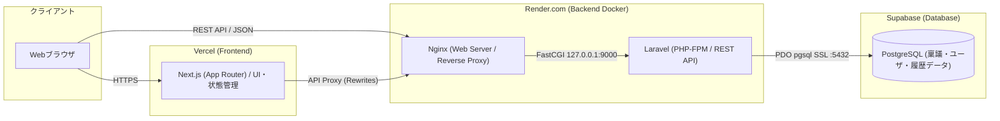
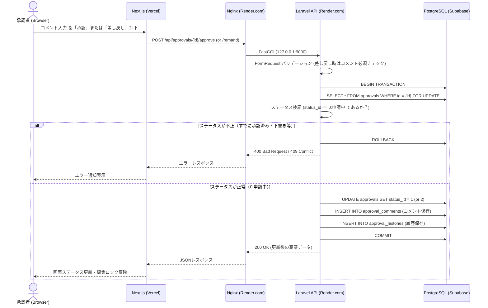

# システムアーキテクチャ設計書 (architecture.md)

本ドキュメントでは、稟議・承認ワークフローシステムにおける技術スタック、インフラ・デプロイ構成、ディレクトリ構造、およびアプリケーションのレイヤー設計を定義します。

---

## 1. 技術スタック一覧

| レイヤー | 採用技術 | ホスティング先（本番公開） | 役割・選定理由 |
| --- | --- | --- | --- |
| **フロントエンド** | **Next.js 15.5.28** (React 18 / TypeScript / App Router) | **Vercel** | ・一覧、起案、詳細・承認画面を提供<br>・Vitest 4 / React Testing LibraryでUI・APIクライアントをテスト |
| **Webサーバ** | **Nginx** | **Render.com** (Docker) | ・リバースプロキシおよびLaravel (PHP-FPM) へのFastCGI通信<br>・静的ファイル配信、セキュリティヘッダ制御 |
| **バックエンド** | **Laravel** (PHP 8.x / APIモード) | **Render.com** (Docker) | ・堅牢なルーティング、FormRequestによるバリデーション<br>・Eloquent ORMによるリレーション管理とトランザクション制御 |
| **データベース** | **PostgreSQL** | **Supabase** | ・厳格な型制約・外部キー制約と高いトランザクション整合性<br>・SupabaseのマネージドPostgreSQL（および必要に応じたSupabase Storage連携） |
| **ローカル開発環境** | **Docker Compose** | ローカルマシン | ・`Next.js` / `Nginx` / `PHP-FPM (Laravel)` / `PostgreSQL` のローカル完全再現<br>・PostgreSQLのデータディレクトリを`./database/postgres`へバインドし、ホスト上のファイルとして保持 |

---

## 2. システム全体構成図

フロントエンド（Next.js on **Vercel**）、バックエンドAPI（Nginx + Laravel on **Render.com**）、データベース（PostgreSQL on **Supabase**）を分離した構成を採用します。

### 2.1. アーキテクチャ図



---

## 3. デプロイ・クラウド公開設計（Vercel × Render.com × Supabase）

### 3.1. 各クラウド基盤の接続・構成詳細

| コンポーネント | クラウドサービス | 構築・接続方式 |
| --- | --- | --- |
| **フロントエンド**<br>(Next.js) | **Vercel** | ・GitHubリポジトリの `frontend/` ディレクトリをRoot Directoryに指定してデプロイ。<br>・環境変数 `BACKEND_API_URL` に Render.com のURL（`https://xxx.onrender.com`）を設定。<br>・`next.config.mjs` の `rewrites` 機能で `/api/:path*` を Render.com 側へプロキシし、CORS問題を回避。 |
| **バックエンド ＋ Nginx**<br>(Laravel + Nginx) | **Render.com**<br>(Web Service / Docker) | ・GitHubリポジトリの `backend/` ディレクトリをRoot Directoryに指定し、`backend/Dockerfile` でデプロイ。<br>・Render.com の無料枠（Web Service）では **1コンテナ単位** でデプロイするため、`backend/Dockerfile` 内で **Nginx と PHP-FPM (Laravel) を同居**（`supervisord` で同時起動）させる。<br>・Nginxが Render の公開ポート（`:80` / `$PORT`）で待ち受け、`127.0.0.1:9000` の PHP-FPM へ FastCGI 転送する。 |
| **データベース**<br>(PostgreSQL) | **Supabase** | ・Supabase プロジェクトを作成し、提供される PostgreSQL 接続情報を Render.com の環境変数に設定。<br>・Laravelの `.env` にてSSL接続設定を行い安全に通信する（環境変数の詳細は `.env` および `docs/memo.md` を参照）。<br>・※添付ファイル（`approval_files`）の実体保存先としても、将来的に Supabase Storage (S3互換) をそのまま利用可能。 |

---

## 4. ディレクトリ構成（モノレポ構成）

ローカル開発（Docker Compose）と本番デプロイ（Vercel / Render.com）の両方で、`backend/` と `frontend/` それぞれが単体でビルド・デプロイ完結できるよう、各ディレクトリ直下に `Dockerfile` を配置する構成とします。

```text
PRJ_ApprovalSystem/
├── docker-compose.yml          # ローカル開発用 (frontend, backend, db)
├── render.yaml                 # Render.com デプロイ定義 (rootDir: backend)
├── .env                        # 環境変数設定ファイル (Git管理外)
├── database/
│   └── postgres/               # PostgreSQLデータディレクトリ (Git管理外・Composeでバインド)
│
├── docs/                       # 設計ドキュメント群
│   ├── spec.md                 # 要件定義・仕様書
│   ├── DB.md                   # DB設計書
│   ├── architecture.md         # アーキテクチャ設計書（本ファイル）
│   └── memo.md                 # 環境変数・機密設定メモ
│
├── backend/                    # Laravel + Nginx プロジェクト (Render.comデプロイ対象)
│   ├── Dockerfile              # Nginx + PHP-FPM 8.x 同居コンテナ定義
│   ├── docker/                 # バックエンドコンテナ用設定ファイル群
│   │   ├── default.conf        # Nginx設定（/api -> PHP-FPM への流し込み）
│   │   ├── php.ini             # PHP設定
│   │   ├── supervisord.conf    # Nginx と php-fpm のプロセス同時管理
│   │   └── entrypoint.sh       # 起動時のマイグレーション & キャッシュクリアスクリプト
│   ├── app/
│   │   ├── Http/
│   │   │   ├── Controllers/Api/
│   │   │   │   ├── ApprovalController.php
│   │   │   │   ├── ApprovalActionController.php
│   │   │   │   ├── ApprovalCommentController.php
│   │   │   │   └── MasterController.php
│   │   │   └── Requests/       # バリデーション (FormRequest)
│   │   ├── Models/             # Eloquent モデル (Approval, User, Department 等)
│   │   ├── Repositories/       # DB操作・クエリ組み立て専任層 (ApprovalRepository, MasterRepository)
│   │   └── Services/           # 業務ロジック・状態遷移・トランザクション制御層
│   ├── database/
│   │   ├── migrations/         # docs/DB.md に準拠したマイグレーション
│   │   └── seeders/            # 初期マスタ・テスト用起案者/承認者データ
│   └── routes/
│       └── api.php             # APIルーティング定義
│
└── frontend/                   # Next.js プロジェクト (Vercelデプロイ対象)
    ├── Dockerfile              # ローカル開発用 Node.js (Next.js) コンテナ定義
    ├── src/
    │   ├── app/                # App Router ページ群
    │   │   ├── layout.tsx      # Workspace共通レイアウト・操作ユーザ切替
    │   │   ├── page.tsx        # 稟議一覧（自分の申請 / 他人の承認）
    │   │   └── approvals/
    │   │       ├── new/page.tsx        # 稟議新規作成・下書き保存画面
    │   │       └── [id]/
    │   │           ├── page.tsx        # 稟議詳細・承認/差し戻し・コメント画面
    │   │           └── edit/page.tsx   # 下書き・差し戻し編集（再申請）画面
    │   ├── components/         # AppShell、WorkspaceContext、ApprovalForm
    │   ├── api.ts              # APIクライアントとデータ型
    │   └── __tests__/          # Vitest / React Testing Libraryテスト
    ├── next.config.mjs
    └── package.json
```

---

### ローカルPostgreSQLデータの永続化

Docker ComposeのPostgreSQLは`./database/postgres`を`/var/lib/postgresql/data`へバインドします。DBコンテナを再作成してもホスト側にデータが残ります。このディレクトリは`.gitignore`対象です。

ファイル同期サービスを使う場合、PostgreSQL稼働中のデータディレクトリを同期・複製すると不整合や破損の原因になります。同期前にDBコンテナを停止し、同じデータディレクトリを複数端末で同時に起動しないでください。

## 5. アプリケーション層・責務設計

### 5.1. フロントエンド設計 (Next.js)
1. **擬似認証（操作ユーザ切替）の仕組み**
    - ログイン画面を省略し、`WorkspaceContext`で現在の操作ユーザを管理します。選択は`localStorage`に保存し、`applicant`は「一般ユーザ」、`approver` / `admin`は「管理ユーザ」と表示します。
    - APIリクエストに`X-Current-User-Id`を付けてLaravelへ送信します。これは課題用の擬似認証であり、本番の認証・本人確認の代替ではありません。
    - 新規起案は一般ユーザ・管理ユーザのどちらでも可能です。承認担当者には起案者本人を選択できません。
2. **一覧のビュー切替**
    - 「自分の申請」は`applicant_user_id`、「他人の承認」は`assignee_user_id`でAPIを絞ります。各ビュー内でステータス、キーワード、部署、店舗を追加フィルタできます。
3. **ステータスに応じたUI制御**
   - `status_id === 1`（承認済み）: 編集ボタン・取り下げボタンを非表示（閲覧専用ロック）。
   - `status_id === 0`（申請中）: 起案者には「取り下げ」ボタン、承認者（担当者）には「承認」「差し戻し」フォームを表示。
   - `status_id === 2`（差し戻し）/ `3`（下書き）: 起案者に「編集」「申請（再申請）」ボタンを表示。

### 5.2. Webサーバ設計 (Nginx)
- クライアント（またはNext.js）からの `/api/*` リクエストを受け付け、`fastcgi_pass` で Laravel (`php-fpm:9000`) の `public/index.php` にルーティングします。
- 添付アップロードの上限として`client_max_body_size 20M`を設定し、CORSヘッダを付与します。

### 5.3. バックエンド設計 (Laravel)
ControllerやServiceにDBクエリ操作が混在するのを防ぎ、**「ステータス遷移の整合性（業務ロジック）」** と **「データアクセス（DB操作）」** を明確に分離するため、`Controller → Service → Repository → Model` の4層構造を採用します。

- **Controller層**: リクエストの受取とJSONレスポンスの返却に専念（直接ModelやRepositoryは呼ばず、Serviceのみを呼び出す）。
- **FormRequest層**: 必須項目チェック、差し戻し時のコメント必須チェックなどを実施。
**Service層 (`ApprovalWorkflowService` / `MasterService`)**:
- **業務ルール・状態遷移ガード**: 承認済み稟議への編集・取り下げや、申請中以外への承認・差し戻しをドメインエラー（`400` / `403`）として遮断。
- **閲覧権限ガード**: 一覧・詳細は申請者本人または担当者本人に限定し、下書きは申請者本人以外から隠す。操作ユーザ未指定時は一覧を空にし、詳細は拒否する。
- **コメント状態遷移**: 申請者本人に限り、未読→既読→対応済みの順序遷移だけを許可する。
- **DBトランザクション境界 (`DB::transaction`)**: 稟議更新、コメント追加、履歴記録を単一トランザクションで束ねる。

**Repository層 (`ApprovalRepository` / `MasterRepository`)**:
- **DB操作・クエリ組み立て専任**: Eloquent (`Approval`, `ApprovalHistory`, `ApprovalComment`, `ApprovalFile`, `User` 等) を用いた検索フィルタの組み立て、悲観ロック (`lockForUpdate`)、レコード作成・更新処理を一元管理。
- **ファイル保存**: 添付実体はLaravelのprivate local disk（`backend/storage/app/private/approvals/{approval_id}`）へ保存し、`approval_files.file_url`には相対パスを記録します。ダウンロードは閲覧権限を確認するAPI経由で行います。

### 5.4. テスト
- バックエンド: `cd backend && php artisan test`（Unit / Feature）
- フロントエンド: `cd frontend && npm test`（Vitest / React Testing Library）

---

## 6. REST API エンドポイント設計

| HTTPメソッド | エンドポイント | 概要 | 実行ロール |
| --- | --- | --- | --- |
| `GET` | `/api/masters` | 初期表示用のユーザ一覧、部署一覧、店舗一覧、ステータス一覧を取得 | 共通 |
| `GET` | `/api/approvals` | 稟議一覧取得（申請者本人または担当者本人の稟議のみ。ステータス等で追加フィルタ） | 申請者本人 / 担当者本人 |
| `POST` | `/api/approvals` | 稟議の新規作成。multipartで添付ファイルを追加可能 | 起案者（一般ユーザ / 管理ユーザ） |
| `GET` | `/api/approvals/{id}` | 稟議詳細取得（コメント・履歴・添付を含む）。下書きは申請者本人のみ | 申請者本人 / 担当者本人 |
| `GET` | `/api/approvals/{id}/files/{fileId}` | 添付ファイルのダウンロード（稟議の閲覧権限を適用） | 申請者本人 / 担当者本人 |
| `PUT` | `/api/approvals/{id}` | 下書き（`3`）または差し戻し（`2`）状態の稟議編集・本申請/再申請。multipartで既存添付の保持・削除・新規追加が可能（フロントは`POST` + `_method=PUT`） | 起案者 |
| `POST` | `/api/approvals/{id}/withdraw` | 申請中（`0`）の稟議を取り下げ、下書き（`3`）へ戻す | 起案者 |
| `POST` | `/api/approvals/{id}/approve` | 申請中（`0`）の稟議を承認済み（`1`）へ変更（任意コメント同時登録） | 承認者 |
| `POST` | `/api/approvals/{id}/remand` | 申請中（`0`）の稟議を差し戻し（`2`）へ変更（**コメント必須**） | 承認者 |
| `POST` | `/api/approvals/{id}/comments` | 稟議に対する通常コメントの追加（画面では閲覧可能な関係者が利用） | 操作ユーザ指定 |
| `PATCH` | `/api/approvals/{id}/comments/{commentId}/status` | コメント状態を次段階へ更新（`0→1` / `1→2`） | 申請者本人 |

---

## 7. ワークフロー処理シーケンス（承認・差し戻し時）


