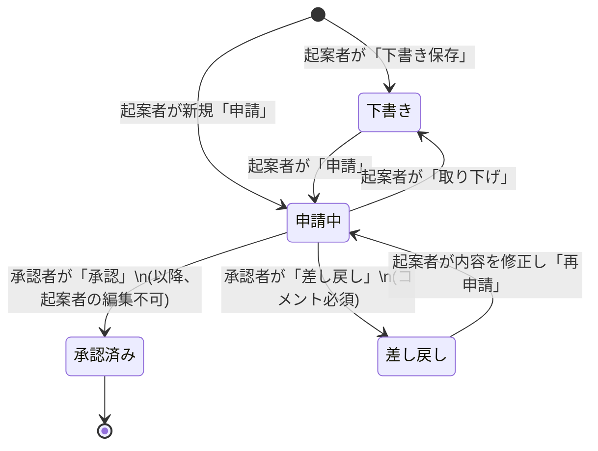

# 稟議・承認ワークフローシステム 要件定義・仕様書 (spec.md)

## 1. システム概要・目的
社内（各部署・各店舗）における物品購入・契約・経費支出などの意思決定（稟議）をオンライン化し、**「下書き・起案（申請） → 承認 / 差し戻し → 再申請」** のワークフローと履歴・コメントを一元管理するシステム。

- **背景・課題**: Excel等の稟議シートによる管理では、承認状況の追跡、差し戻し時の再編集・履歴管理、過去案件の検索が煩雑になりやすい。
- **本システムのゴール**: 起案者と承認者の責務およびステータスに応じた操作制御（承認後の編集ロック、差し戻し時の再申請など）を明確にし、透明性の高い承認フローを実現する。

---

## 2. ユーザとロール定義

※複雑なログイン認証は設けず、画面上のユーザ切替で操作ユーザを指定する。画面表示名は`authority = applicant`を「一般ユーザ」、`authority = approver`または`admin`を「管理ユーザ」とする。APIは操作ユーザIDを`X-Current-User-Id`またはリクエスト値で受け取る。

| ロール | 概要 | 主な操作権限 |
| --- | --- | --- |
| **一般ユーザ (Applicant)** | 各部署・店舗の担当者。稟議を作成して申請する。 | ・稟議の新規作成・下書き保存・申請 ・自身が起案した稟議の閲覧・取り下げ（下書きへ戻す） ・「下書き」「差し戻し」状態の稟議の編集・申請（再申請） ・コメントの投稿・閲覧 ・自身が起案した稟議のコメント状態を「未読→既読→対応済み」の順で更新 |
| **管理ユーザ (Approver / Admin)** | 店長・部門長などの決裁権者。申請された稟議を審査する。 | ・稟議の新規作成・下書き保存・申請 ・自身が承認担当者に設定されている稟議（「下書き」を除く）の一覧・詳細閲覧 ・「申請中」の稟議に対する **承認** または **差し戻し** ・承認/差し戻し時のコメント記入 ・コメントの投稿・閲覧（コメント状態の変更は不可） |

稟議の閲覧対象は、起案者本人または承認担当者本人に限る。管理ユーザであっても、起案者・承認担当者のどちらでもない稟議は閲覧できない。下書きは起案者本人のみ閲覧できる。
起案者と承認担当者には、同じユーザを指定できない。

---

## 3. ステータス遷移と制御仕様（ワークフロー設計）

### 3.1. ステータス定義
| ステータスID | 状態名 | 説明 | 起案者の編集・申請 | 承認者の承認・差し戻し |
| :---: | --- | --- | :---: | :---: |
| `0` | **申請中** | 起案者が申請し、承認者の判断を待っている状態 | 不可（※1） | **可能** |
| `1` | **承認済み** | 承認者によって承認が完了した最終状態 | **不可（編集ロック）** | 不可 |
| `2` | **差し戻し** | 承認者から修正・再検討を求められた状態 | **可能（編集・再申請）** | 不可 |
| `3` | **下書き** | 起案者が申請前に一時保存した（または申請を取り下げた）状態 | **可能（編集・本申請）** | 不可（承認者一覧には非表示） |

> ※1: 「申請中」の稟議を起案者が修正したい場合は、一度「取り下げ」を実行してステータスを `3: 下書き` に戻してから編集・再申請を行う（または承認者から `2: 差し戻し` してもらう）仕様とする。

### 3.2. 状態遷移図 (State Diagram)

---

## 4. 機能要件（一覧）

課題の時間目安（3〜5時間）を踏まえ、**【必須機能 (MVP)】** と、一般的な稟議システムとして考慮すべき **【拡張・加点機能】** に分類して定義する。

### 4.1. 【必須機能 (MVP)】（本課題で確実に実装する範囲）

1. **操作ユーザ切替機能（簡易ログイン代替）**
   - ヘッダー等で「起案者（例：山田 太郎 / 営業部・渋谷店）」「承認者（例：佐藤 部長 / 本部）」をプルダウン等で即座に切り替えられる機能。
2. **稟議一覧・検索・フィルタ機能**
   - 一覧上部のビュータブを「自分の申請」「他人の承認」に分ける。「自分の申請」は操作ユーザが起案者の稟議、「他人の承認」は操作ユーザが承認担当者の稟議を表示する。
   - 登録されている稟議を一覧表示（起案日、件名、部署名、店舗名、起案者名または承認担当者名、金額、ステータス）。自分の申請ビューの担当者列は「承認担当者」と表示する。
   - 各ビュー内でステータス（すべて / 下書き / 申請中 / 承認済み / 差し戻し）、キーワード、部署、店舗で絞り込む。承認担当者ビューでは下書きを表示しない。
3. **稟議新規作成（起案・下書き保存）機能**
   - 起案日（自動または指定）、部署名、店舗名、担当者名（ユーザ選択または未定/外部手入力）、件名、金額、詳細、理由を入力する。
   - 「下書き保存」（ステータス `3: 下書き`）または「申請する」（ステータス `0: 申請中`）を選択して登録できる。
4. **稟議詳細表示機能**
   - 稟議の全項目、現在のステータス、これまでのコメント一覧、更新履歴を1画面で確認できる。
5. **承認・差し戻し機能（承認者のみ）**
   - ステータスが「申請中」の稟議に対し、コメントを添えて「承認」または「差し戻し」を実行する。
   - **承認時**: ステータスを `1: 承認済み` に変更し、以降の編集をロックする。
   - **差し戻し時**: ステータスを `2: 差し戻し` に変更し、差し戻し理由コメントの入力を必須とする。
6. **下書き・差し戻し案件の編集・申請（再申請）および取り下げ機能（起案者のみ）**
   - ステータスが `3: 下書き` または `2: 差し戻し` の稟議に対し、件名・金額・詳細・理由などを編集し、「下書き保存」または「申請（再申請）」（ステータス `0: 申請中` へ変更）を行える。
   - ステータスが `0: 申請中` の稟議に対し、承認される前であれば「取り下げ」を実行して `3: 下書き` に戻すことができる。
7. **コメント機能**
   - 承認・差し戻し時のコメント記録、および稟議詳細画面での質疑応答コメントの投稿・一覧表示。

### 4.2. 拡張・追加機能

1. **稟議更新履歴（監査ログ）の自動記録・表示 (`approval_histories`)**
   - 「いつ・誰が・何をしたか（下書き作成 / 新規申請 / 取り下げ / 承認 / 差し戻し / 再申請）」を自動記録し、詳細画面のタイムラインに表示する。
2. **添付ファイル管理機能 (`approval_files`)（実装済み）**
   - 見積書や参考資料などを実ファイルとしてアップロードし、稟議に紐づけて登録・一覧表示する。
   - 対応形式はPDF、JPEG、PNG、Word、Excel。1ファイル20MB以下、1稟議あたり合計10ファイルまで。
   - 下書き・差し戻しの編集時は既存ファイルを保持または削除でき、新規ファイルも追加できる。
   - ファイル本体はprivate storageに保存し、申請者または承認担当者が権限付きAPIからダウンロードする。
3. **コメントの既読・対応ステータス管理 (`approval_comments.status`)**
   - 起案者本人のみが、自身の稟議に紐づくコメント状態を「未読→既読→対応済み」の順で更新できる。
   - 「未読→対応済み」「既読→未読」「対応済みからの変更」など、それ以外の遷移はAPIで拒否する。

---

## 5. 画面構成案

シンプルかつ直感的に操作できるよう、主に以下の3画面（またはモーダル構成）とする。

1. **稟議一覧画面（トップ画面）**
   - **上部バー**: 操作ユーザ切替セレクタ、「＋ 新規稟議を作成」ボタン
   - **ビュータブ**: 「自分の申請」「他人の承認」。操作ユーザの役割に応じたビューを初期表示
   - **フィルタ**: ステータスタブ（全件 / 下書き / 申請中 / 差し戻し / 承認済み）、キーワード・部署・店舗フィルタ
   - **一覧テーブル**: ステータス（色分けバッジ）、起案日、件名、部署・店舗、起案者または承認担当者、金額、詳細リンク
2. **稟議新規作成 / 編集（下書き・再申請）画面**
   - **入力フォーム**:
     - 起案者情報（部署、店舗、起案者名：ログイン中ユーザから自動セット）
     - 担当者（ユーザ選択プルダウン ＋ 未定・外部用の自由入力欄）
     - 件名（必須）
     - 金額（必須、数値・0円以上）
     - 詳細（必須、複数行テキスト）
     - 理由（必須、複数行テキスト）
   - 添付ファイル（任意。PDF/JPEG/PNG/DOC/DOCX/XLS/XLSX、1ファイル20MB以下、1稟議10ファイル以下。編集時は既存添付の削除も可能）
   - **アクションボタン**: 「申請する」（差し戻し編集時は「再申請する」）、「下書き保存する」、キャンセル
3. **稟議詳細・承認画面**
   - **基本情報エリア**: ステータスバッジ、起案日、部署・店舗、起案者、担当者、件名、金額（カンマ区切り表示）、詳細、理由、添付ファイル一覧（権限付きダウンロード）
   - **起案者用アクションエリア**:
     - ステータスが `3: 下書き` または `2: 差し戻し` の場合: 「編集する」「申請（再申請）する」ボタン
     - ステータスが `0: 申請中` の場合: 「申請を取り下げる（下書きに戻す）」ボタン
   - **承認者用アクションエリア**（※承認者かつステータスが `0: 申請中` の場合のみ表示）:
     - コメント入力欄（差し戻し時は入力必須）
     - 「承認する」ボタン、「差し戻す」ボタン
    - **コメント・履歴エリア**:
       - コメント一覧＆新規コメント投稿フォーム
       - 起案者本人にはコメント状態の次段階（未読なら既読、既読なら対応済み）のみ選択可能にする。承認担当者には状態変更操作を表示しない。
       - 更新履歴タイムライン（下書き → 申請 → 差し戻し → 再申請 → 承認 のログ）

---

## 6. バリデーション・業務ルール（エッジケース定義）

1. **入力チェック（起案・下書き・再申請時）**
   - `件名`: 必須、1〜255文字以内（※下書き保存時も一覧識別のために件名のみ必須とし、他項目は申請時に必須チェックを行う設計も可）
   - `金額`: 申請時は必須、0以上の整数
   - `詳細` / `理由`: 申請時は必須、空白のみは不可
   - `担当者`: 担当者ユーザ未選択（不明ユーザ `id=0`）の場合、`担当者名` テキストに「未定」または外部担当者名を入力可能とする
   - `添付ファイル`: 許可形式のみ、1ファイル20MB以下。編集時に残す既存IDは対象稟議に属する未削除レコードに限り、アップロード後の合計は10件以下とする。
   - `添付ファイル`: PDF/JPEG/PNG/DOC/DOCX/XLS/XLSXのみ、1ファイル20MB以下、1稟議10ファイル以下
2. **権限・状態チェック（不正操作防止）**
   - **承認済みの編集禁止**: `status_id = 1`（承認済み）の稟議に対する更新・取り下げリクエストは、画面上でボタンを非表示にするだけでなく、バックエンドAPIでも `400 Bad Request` / `403 Forbidden` として拒否する。
   - **編集可能ステータスの制限**: 起案者が内容を直接編集できるのは `status_id = 3`（下書き）および `status_id = 2`（差し戻し）のみとする。`status_id = 0`（申請中）を修正したい場合は、まず「取り下げ（`status_id = 3` への変更）」を行う。
   - **稟議の閲覧制限**: 一覧・詳細とも起案者本人または承認担当者本人に限定する。担当者であっても下書き（`status_id = 3`）は閲覧できず、起案者本人のみ閲覧・操作可能とする。ユーザIDが未指定の場合は一覧を空にし、詳細は`403 Forbidden`で拒否する。
   - **承認/差し戻し対象制限**: `status_id = 0`（申請中）以外の稟議に対して承認・差し戻しを実行することはできない。
   - **差し戻し時のコメント必須**: 差し戻し実行時にコメントが空の場合はエラーとし、起案者が何を修正すべきか分かるようにする。
   - **コメント状態の更新制限**: 起案者本人のみが変更でき、`0: 未読→1: 既読`、`1: 既読→2: 対応済み`だけを許可する。それ以外は`403 Forbidden`または`422 Unprocessable Entity`で拒否する。
3. **論理削除の扱い**
   - 各テーブルの `is_deleted = TRUE` のレコードは、通常の一覧・詳細検索結果から除外する。
